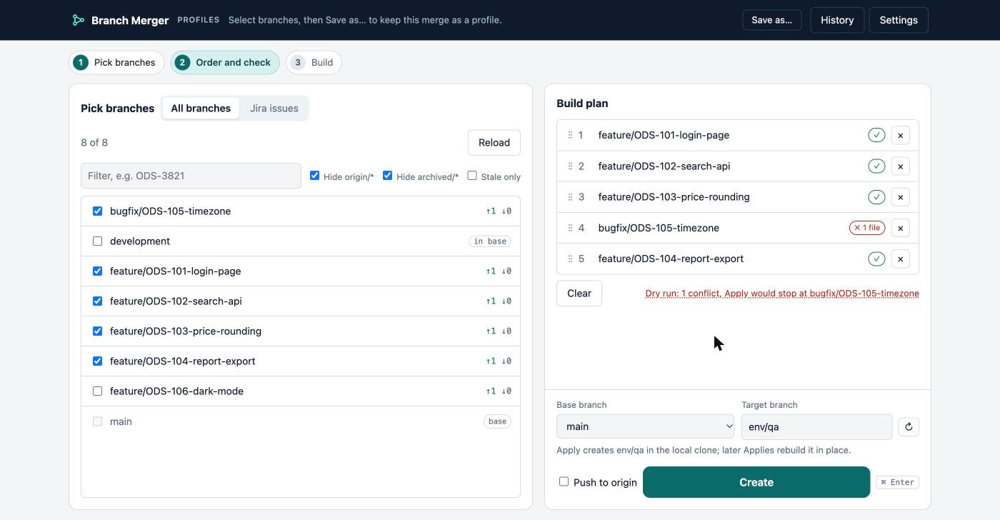
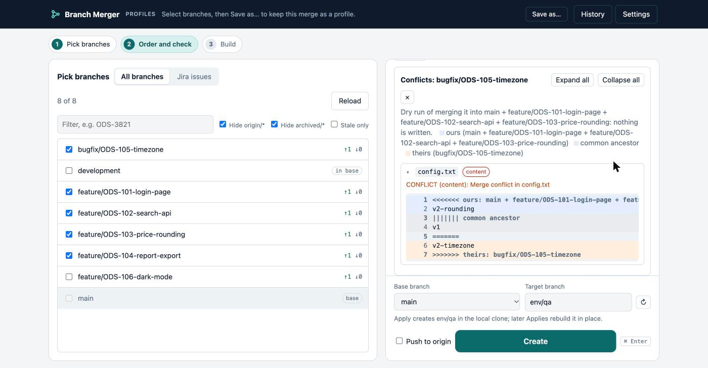

# Branch Merger

> **Tired of building the QA branch by hand?**
> Checking out `main`, cutting a new branch, merging ten feature branches one by one, hitting a conflict on the seventh, and starting over?
>
> **Branch Merger does it for you.**
> ✅ Pick your branches and press one button
> ✅ See every conflict *before* you merge
> ✅ Rebuild `env/qa` or `env/staging` in seconds, as often as you like
> ✅ Your working copy and current branch are never touched

Build a staging or QA branch from several feature branches in one click.

Pick the branches you want, put them in order, and press **Create**. The tool cuts a branch from your base (for example `main`) and merges every selected branch into it. Before anything is written, a dry run checks each branch and flags the ones that would conflict.



If a branch conflicts, open it to see the conflicting lines, so you can fix them before you build.



## Getting started

```sh
python3 main.py --repo /path/to/your/clone
```

Then open <http://127.0.0.1:8765>.

Needs Python 3.9+, `git` 2.38+ and a modern browser. No packages to install.

## Good to know

- **Your working copy is never touched.** Merges run in a temporary worktree.
- **Nothing is pushed unless you ask.** Tick **Push to origin** next to Create.
- **A conflict changes nothing.** The target branch only moves if every merge succeeds.
- **Fix a conflict once.** In the conflict view, **Open in editor** stops the merge on that branch's conflicts in a folder next to your clone (`<clone>-conflicts/<branch>`) and opens it in VS Code or Cursor (Settings › Build). Fix the files, press **Save fix**, and every later dry run and Apply reuses the fix (git rerere). After the first saved fix, git rerere also applies to merges you run yourself in that clone.
- **Profiles** save a setup (branches, order, base, target) so you can rebuild `env/qa` or `env/staging` later with one click.
- **Jira** (optional): list issues from a filter or JQL and add their branches. Set it up in **Settings › Jira**.
- **GitHub mode** (optional): work against the GitHub API instead of a local clone. Set it up in **Settings › Source**.

## Tests

```sh
python3 -m unittest
```
